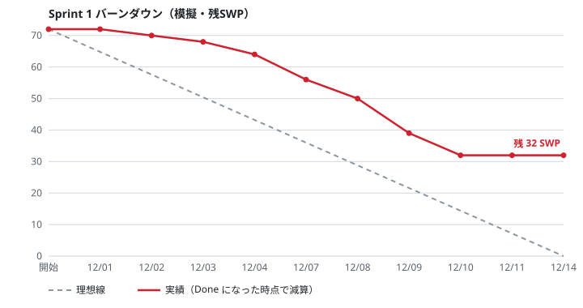

# 進捗報告書 — Sprint 1（模擬）

ご担当者様

コールドチェーン業務システム（Product B）Release 1 開発の Sprint 1 についてご報告いたします。

> 本報告は**模擬スプリント**です。進捗・実績時間は想定シナリオに基づく値であり、実際の作業実績ではありません。

**結論：** Sprint 1 の完了率は 56% でした。この結果から、M1（基盤・権限、12/28）は期日どおりには達成できない見込みです。M3（R1 開発完了、3/8）も、BE の体制を増やしても期日どおりの達成は困難です。対応方針について 12/18 までにご判断をお願いいたします（§4 R1・R2）。

## 1. イテレーションと模擬期間

| 項目 | 内容 |
|---|---|
| イテレーション | **Sprint 1**（GitHub Project の Iteration フィールド） |
| 模擬期間 | 2026年12月1日（火）〜 12月14日（月）、稼働 10 日 |
| スプリントゴール | 環境構築、DB 書き込み経路のロック、作業を止めている貴社確認事項の解消 |
| 体制 | 6 名（BE-1、BE-2、FE-1、FE-2、QA-1、BrSE）。1 人あたり 51 時間／スプリント（1 日 6 時間 × 10 日 × 85%） |
| 対象 | 23 件・72 SWP・見積 216 時間（稼働可能 306 時間の 71%） |
| ボード | [Project — Sprint 1 で絞り込み](https://github.com/users/tamnv-1080/projects/2?filterQuery=iteration%3A%22Sprint+1%22) |

SWP（Standard Work Point）は、作業の規模と難易度から求める相対的な工数指標です。時間への換算は 1 SWP あたり画面 5.5 時間、それ以外 3.0 時間です。

**対象の選び方：** 依存先がスプリント内で完了できる issue だけを採用し、1 人 51 時間を超えないようにしました。画面の issue はすべて API の完成待ちのため、FE-1・FE-2 には依存のない TypeScript の判定エンジン 6 件を割り当てました。BE がボトルネックになっているため、その負荷を分散する狙いもあります。

| 担当 | 計画（時間） | 稼働可能 | 完了分の見積（時間） | 完了分の実績（時間） |
|---|---|---|---|---|
| BE-1 | 48 | 51 | 36 | 39 |
| BE-2 | 48 | 51 | 24 | 30 |
| FE-1 | 33 | 51 | 18 | 23 |
| FE-2 | 27 | 51 | 18 | 21 |
| QA-1 | 18 | 51 | 12 | 12 |
| BrSE | 42 | 51 | 12 | 13 |

**計画に入らなかった稼働：** 306 時間のうち約 90 時間（FE 42 時間、QA 33 時間ほか）は、依存関係のため着手できる issue がなく、計画に入っていません。QA の手動テスト設計は、まだ issue として登録されていません（R8）。

**マイルストーン（当初計画）：** M1 基盤・権限 2026-12-28（Sprint 2 末）／M2 R1.1★仕様確定 2027-01-25（Sprint 4 末）／M3 R1 開発完了 2027-03-08（Sprint 7 末、BE 増員が前提）。Sprint 3 は年末年始と成人の日のため稼働 5 日です。R1.1★は本番稼働の前提となる追加機能（POD オフライン等）です。

## 2. ステータス別集計（12月14日終了時点）

| ステータス | 件数 | 合計 SWP | 備考 |
|---|---|---|---|
| Done | 13 | 40 | 4 環境の構築（[#13](https://github.com/tamnv-1080/coldchain-lab5-backlog/issues/13)）、BFF 規約の lint ルール（[#15](https://github.com/tamnv-1080/coldchain-lab5-backlog/issues/15)）、service-client のサーバー限定化（[#16](https://github.com/tamnv-1080/coldchain-lab5-backlog/issues/16)）、共通エラーライブラリ（[#20](https://github.com/tamnv-1080/coldchain-lab5-backlog/issues/20)）、テスト基盤（[#21](https://github.com/tamnv-1080/coldchain-lab5-backlog/issues/21)）、温度 CSV パーサ、引当ルール 2 件、勤務イベント再生エンジン、POD 証跡、確認事項 3 件（インフラ承認、PICKED/LOADED、地図サービス） |
| In Review | 3 | 11 | 書き込み経路ロック（[#17](https://github.com/tamnv-1080/coldchain-lab5-backlog/issues/17)、PR 12/14 提出。RPC の呼び出し箇所が設計より多く、レビュー量が増加）、FEFO（[#78](https://github.com/tamnv-1080/coldchain-lab5-backlog/issues/78)）、運転時間ルール要約（[#151](https://github.com/tamnv-1080/coldchain-lab5-backlog/issues/151)、**貴社ご確認待ち**、12/18 ご回答予定） |
| In Progress | 4 | 15 | 入荷データ検証（[#46](https://github.com/tamnv-1080/coldchain-lab5-backlog/issues/46)、残り約 1 日）、地図 API 検証（[#105](https://github.com/tamnv-1080/coldchain-lab5-backlog/issues/105)、ご回答待ちのため着手は 12/11）、日付逆転ルール（[#77](https://github.com/tamnv-1080/coldchain-lab5-backlog/issues/77)、残り約 40%。納品先が複数ある得意先の比較方法が未確定）、R1.1 POD オフライン仕様（[#160](https://github.com/tamnv-1080/coldchain-lab5-backlog/issues/160)、約 50%） |
| Blocked | 2 | 3 | 貴社認証基盤（IdP）の情報のご回答待ち（[#33](https://github.com/tamnv-1080/coldchain-lab5-backlog/issues/33)）、書き込み経路ロックのテストが #17 待ち（[#22](https://github.com/tamnv-1080/coldchain-lab5-backlog/issues/22)） |
| Todo | 1 | 3 | CHECK 制約・インデックス追加（[#19](https://github.com/tamnv-1080/coldchain-lab5-backlog/issues/19)）。#13 が見積を超えて BE-2 の時間が不足し、未着手 |
| **合計** | **23** | **72** | 完了率 56%（40 / 72 SWP） |

- 集計は末端の issue（SWP を持つもの）のみです。親 issue の [#73](https://github.com/tamnv-1080/coldchain-lab5-backlog/issues/73)（引当エンジン）は二重計上を避けるため除外しています。
- **Sprint 2 への繰越：** 10 件・32 SWP・見積 96 時間（Sprint 1 の 44%）。Sprint 2 の稼働をその分使います。

**トラック運転時間規制（2024年）関連：** 対象 4 件。

- 完了 2 件：勤務イベント再生エンジン [#137](https://github.com/tamnv-1080/coldchain-lab5-backlog/issues/137)、地図サービス確認 [#104](https://github.com/tamnv-1080/coldchain-lab5-backlog/issues/104)
- 貴社確認待ち 1 件：ルール要約 #151
- 作業中 1 件：地図 API 検証 #105

拘束時間の判定エンジン本体（[#113](https://github.com/tamnv-1080/coldchain-lab5-backlog/issues/113)、[#114](https://github.com/tamnv-1080/coldchain-lab5-backlog/issues/114)）は未着手です。

## 3. バーンダウン

| 日付 | 稼働日 | 理想線（SWP） | 残 SWP | 残 見積時間 |
|---|---|---|---|---|
| 開始 | 0 | 72 | 72 | 216 |
| 12/01 | 1 | 64.8 | 72 | 216 |
| 12/02 | 2 | 57.6 | 70 | 210 |
| 12/03 | 3 | 50.4 | 68 | 204 |
| 12/04 | 4 | 43.2 | 64 | 192 |
| 12/07 | 5 | 36 | 56 | 168 |
| 12/08 | 6 | 28.8 | 50 | 150 |
| 12/09 | 7 | 21.6 | 39 | 117 |
| 12/10 | 8 | 14.4 | 32 | 96 |
| 12/11 | 9 | 7.2 | 32 | 96 |
| 12/14 | 10 | 0 | 32 | 96 |

**読み方：** issue が Done になった日に、その SWP を一括で減算しています。作業途中の進捗は反映しません。

- **前半が緩やかな理由：** 大きな issue（環境構築 8 SWP、service-client 5 SWP）の完了が 5〜7 日目に集中しました。環境構築は UAT・本番環境のご承認（#23）を待ち、6 日目のご承認後に完了しました。
- **9〜10 日目が横ばいの理由：** 残りの issue はレビュー中、作業途中、または貴社のご回答待ちで、新たに完了したものはありません。
- **達成率は 56%（40 / 72 SWP）です。** レビュー中の 3 件のうち #151 は貴社のご回答次第です。#17 もレビュー量が増えています。このため、Sprint 2 序盤に完了すると見込めるのは #78 のみです。
- **見積との差：** 完了 13 件の実績は 138 時間で、見積 120 時間の 1.15 倍でした。BE 担当分は 1.15 倍、FE が担当した判定エンジンは 1.22 倍です。
  - BE-2 は #13 の超過で #19 に着手できず、すでに計画に影響が出ています。
  - 未完了の issue の超過（#17 など）はこの比率に含まれていないため、実際の差はこれより大きい可能性があります。
- **R1 完了の見通し：** ボトルネックである BE から算出しました。
  - BE の残作業は約 1,090 時間です。BE 2 名の稼働は 1 スプリント 102 時間なので、約 11 スプリント必要です。
  - これは Sprint 12 末（2027-05-17）にあたります。年末年始とゴールデンウィークの稼働減を含めると、6 月上旬になります。
  - BE が Sprint 1 と同じく計画の 6 割程度しか完了できない場合は、さらに遅れます。
  - 現体制での M3 の見通しは **2027 年 5 月中旬〜6 月上旬** です。

## 4. 遅延リスクと対応

| # | リスク | Issue | 影響するマイルストーン | 対応 | 担当・期限 |
|---|---|---|---|---|---|
| R1 | **M1 が 12/28 に達成できない。** M1 の残作業は 255 時間です。そのうち BE-2 の担当分が 150 時間で、1 スプリントの稼働 51 時間の約 3 倍あります。作業は #17 → 権限 → RLS → 権限テストと順につながっており、並行して進められません | [#17](https://github.com/tamnv-1080/coldchain-lab5-backlog/issues/17) → [#25](https://github.com/tamnv-1080/coldchain-lab5-backlog/issues/25) → [#26](https://github.com/tamnv-1080/coldchain-lab5-backlog/issues/26) → [#39](https://github.com/tamnv-1080/coldchain-lab5-backlog/issues/39)、CI・バックアップ [#14](https://github.com/tamnv-1080/coldchain-lab5-backlog/issues/14) | **M1**（現体制の見通し：2027 年 2 月上旬） | M1 を 2 段階に分けることをご提案します。 ・12/28 までに、書き込み経路ロック（#17、#22）、ロールと権限判定（#25）、API の権限チェック（[#31](https://github.com/tamnv-1080/coldchain-lab5-backlog/issues/31)）を完了します。 ・RLS、CI・バックアップ、監視、SSO は 2027-02-08（Sprint 5 末）に完了します（Sprint 3 は稼働 5 日） | 当社 PM、Sprint 2 計画（12/15）で提示、12/18 までにご承認 |
| R2 | **BE の作業量が体制を超えている。** BE の残作業は約 1,090 時間で、2 名では約 11 スプリントかかります。M3 の 3/8 は、どちらの案でも達成が困難です | BE/DB の issue 全般 | **M3**（当初 2027-03-08） | 次のいずれかをご判断いただきます。 (a) Sprint 3 から BE を 2 名増員する。立ち上がり期間を考慮した見通しは **3 月下旬〜4 月上旬** です。 (b) 増員せず、FE による判定エンジン・API の分担を続ける。見通しは **5 月中旬〜6 月上旬** です。 どちらの場合も、Sprint 2 の実績で見通しを更新します | 当社 PM・貴社、12/18 までにご判断 |
| R3 | 書き込み経路ロックのレビューが長引いている（RPC の呼び出し箇所が設計より多い）。後続の業務処理がすべてこれに依存しています | [#17](https://github.com/tamnv-1080/coldchain-lab5-backlog/issues/17) → 権限 [#25](https://github.com/tamnv-1080/coldchain-lab5-backlog/issues/25)、ロックのテスト [#22](https://github.com/tamnv-1080/coldchain-lab5-backlog/issues/22) | **M1** | 12/15 に BE-1 がレビューを完了し、BE-2 がマージします。#22 は 12/16 に完了させ、#25 は 12/16 に着手します | BE-1（レビュー）・BE-2・QA-1、12/16 |
| R4 | 貴社認証基盤（IdP）の情報が未回答です。12/1 にご質問し、12/7 に再送しました | [#33](https://github.com/tamnv-1080/coldchain-lab5-backlog/issues/33) → SSO [#34](https://github.com/tamnv-1080/coldchain-lab5-backlog/issues/34)、ログイン画面 [#36](https://github.com/tamnv-1080/coldchain-lab5-backlog/issues/36) | **M1**（第 2 段階） | 12/16 の定例で、貴社情報システム部門に直接確認させていただきます。 ご回答が遅れる場合は、UAT 環境に限りメール／パスワード認証で先行する案を、貴社のご承認を前提にご提案します。 この案では SSO と、特権ロールへのログイン時 MFA が UAT では使えないため、UAT の対象者と期間を限定します | 当社 BrSE・貴社情報システム部門、12/18 |
| R5 | 見積が過小である可能性があります。 ・Sprint 1 の実績は見積の 1.15 倍でした。 ・今回の issue 別見積の合計は、ご提案時の概算見積の約 6 割です。入荷・引当・出荷の合計では約 4 割です。 ・画面はまだ着手しておらず、検証できていません | 完了 13 件（§3） | **M3** | Sprint 2 終了時に時間換算の係数を再算定し、全体計画とマイルストーンを更新してご報告します。画面の見積は、最初の画面が完了した時点で検証します | 当社 PM、12/28 |
| R6 | R1.1★仕様（POD オフライン等）の作成が遅れています。貴社への確認対応に BrSE の時間が取られたためです | [#160](https://github.com/tamnv-1080/coldchain-lab5-backlog/issues/160)、[#161〜#164](https://github.com/tamnv-1080/coldchain-lab5-backlog/issues/161) | **M2**（2027-01-25）。R1.1★は本番稼働の前提です | 確認事項を週 1 回の定例に集約し、BrSE が仕様作成に使える時間を確保します。#160 は 12/28 に完了し、残り 4 件は Sprint 3〜4 で作成します | 当社 BrSE、12/28 |
| R7 | 運転時間ルール要約（2024年規制）について、貴社のご確認待ちです。ルール確定前に判定エンジンを実装すると、手戻りが出る可能性があります | [#151](https://github.com/tamnv-1080/coldchain-lab5-backlog/issues/151)（関連：判定エンジン [#113](https://github.com/tamnv-1080/coldchain-lab5-backlog/issues/113)、[#114](https://github.com/tamnv-1080/coldchain-lab5-backlog/issues/114)） | **M3** | 12/18 にご回答いただく予定です。遅れる場合は、ご確認済みのルールから順に実装します | 当社 BrSE・貴社運行管理ご担当者様、12/18 |
| R8 | 手動テスト設計と UAT 準備が issue として登録されておらず、QA の作業が計画に表れていません | — | **M3** 後の UAT 開始 | Sprint 2 計画で issue として登録し、見積を追加します | QA-1・当社 PM、12/15 |
| R9 | 地図サービスのご回答が 4 日遅れ、API 検証（1 日の時間枠）が Sprint 2 に繰り越しました | [#104](https://github.com/tamnv-1080/coldchain-lab5-backlog/issues/104)、[#105](https://github.com/tamnv-1080/coldchain-lab5-backlog/issues/105) → 地図アダプタ [#106](https://github.com/tamnv-1080/coldchain-lab5-backlog/issues/106) | **M3**（ルート計画） | 12/16 までに検証を完了します。API の制約で使えない場合は、代替サービスへの切り替えをご提案します | BE-1、12/16 |

以上
